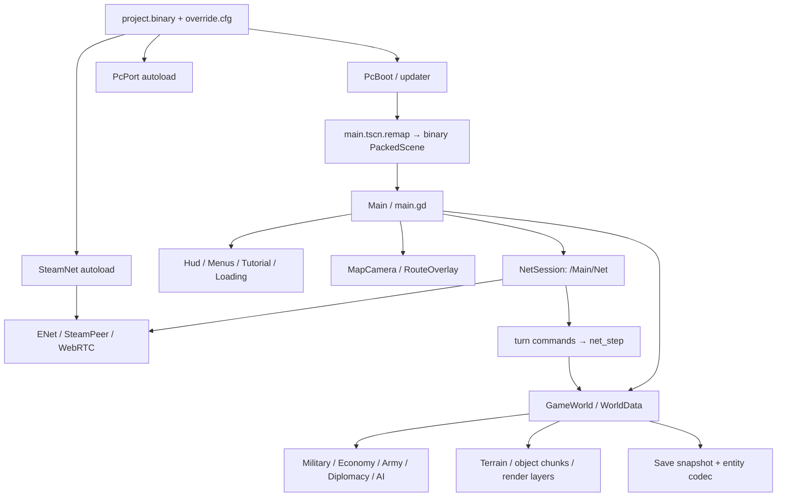

# Архітектура DroneFlames PC port

**Scope після Phase3:** опис нижче стосується development checkout0.33.2.3 на af1b4c9. Release0.41.4.1 досліджений окремо; game/ не замінений. Нова binary boundary наведена наприкінці, source migration BLOCKED — [VERSION_041_ANALYSIS](VERSION_041_ANALYSIS.md), [MIGRATION_041](MIGRATION_041.md).

Підтверджено на `af1b4c9`. Phase2: main-scene resource load/instantiate і normal Linux/Windows headless startup **PASS**; GUI та network-peer smoke **NOT RUN**. Scope/exit diagnostics — [RUNTIME_BASELINE](RUNTIME_BASELINE.md). Для пофайлових меж читання див. [FILE_COVERAGE.md](FILE_COVERAGE.md); автоматичний каталог — [MODULE_INDEX.md](MODULE_INDEX.md).

## Запуск

`game/project.binary` має magic `ECFG`, 26 конфігураційних entries; прочитані скалярні metadata в `dist/codex_audit/project_binary_metadata.json`. Базові параметри: application name DroneFlames, main scene `res://game/main.tscn`, viewport 360×640, stretch `canvas_items/expand`. Це метадані конфігурації, не текстовий source.

`game/override.cfg` змінює main_scene на `res://pc/boot.tscn`, window override на 1600×900, orientation=0; додає autoload `PcPort`, `SteamNet`. `boot.tscn` — Node `PcBoot` із `res://pc/updater.gd`. `_ready/_enabled/_run` updater виконує version/native checks або пропускає їх, `_start_game:193` викликає change_scene_to_file.

`game/game/main.tscn.remap` містить адресу наявної 672-byte `.scn`: `res://.godot/exported/133200997/export-178df499c26bcd3357cc4c21fb1eaa2e-main.scn`. Binary header містить `RSRC/PackedScene`; рядкові metadata — `Main`, `Node`, `script`, `res://game/main.gd`. Phase2 pack probe реально завантажив і інстанціював її, перевірив name/script; normal headless startup окремо пройшов world generation. Не видаляти tracked `.godot/` як звичайний regenerate-able cache: він містить фактичні runtime assets.

Редагований локальний варіант: [droneflames-architecture.drawio](droneflames-architecture.drawio). Схема навмисно агрегує підсистеми; точний порядок симуляції — у [GAMEPLAY_SYSTEMS.md](GAMEPLAY_SYSTEMS.md).

## Конструювання та ownership

`game/game/main.gd::_ready:8` створює World, Camera, Hud, PendingGhost, RouteOverlay, Net, Menus, Tutorial, Loading. Ім'я Net фіксує однаковий RPC path на peer-ах. Hud отримує Main і World, Menus отримує World і Net. Сигнали missile/war/end/capture/offers/news прив'язуються до Main/Hud. Мовний first-run та opening чекають async, далі `_main_menu` генерує demo 512 world з чотирма AI й дрейфом камери. Це живий simulation background, не статична картинка меню.

`game/game/game_world.gd::_ready:7` завантажує SpriteAtlas і створює SceneTree шари рендерингу. `new_world:161` спочатку drain-ить jobs старого світу, очищає стан, створює нові підсистеми з посиланням `gw=self`, генерує WorldData, об'єкти, deposits, navigation, Rail і Cad344 scheduler. Main/World володіють дочірніми Node; симуляційні системи переважно RefCounted з посиланням на World; сутності — RefCounted або Dictionary/packed arrays. Гарантії знищення всіх циклів RefCounted runtime-перевіркою не встановлені.

World тримає `countries/cities/bridges`; Military — facilities/drones/missiles/Air; Army — units; Navy — ships; Economy/Ports/Rail — trade/logistics; NetSession — roster/turn queue/host state. Інший peer має свій `world.player` для UI; симуляція всіх країн існує на кожному пристрої. Відповідність peer→slot→country задає NetSession, transport не володіє gameplay.

## Ланцюги успадкування

Стрілка означає `extends`; кожен шлях наведений від root checkout.

- `game/game/main.gd` → `main/main_input.gd` → `main/main_strike.gd` → `main/main_core.gd` → `main/main_base.gd` → Node.
- `game/game/game_world.gd` → `game_world/gw_states.gd` → `gw_infra.gd` → `gw_map.gd` → `gw_base.gd` → Node2D.
- `game/game/economy.gd` → `economy/eco_trade.gd` → `eco_core.gd` → `eco_base.gd` → RefCounted.
- `game/game/military.gd` → `military/mil_strike.gd` → `mil_build.gd` → `mil_base.gd` → RefCounted.
- `game/game/diplomacy.gd` → `diplomacy/dip_allies.gd` → `dip_rules.gd` → `dip_base.gd` → RefCounted.
- `game/ui/hud.gd` → `hud/hud_lane.gd` → `hud_cards.gd` → `hud_ops.gd` → `hud_dock.gd` → `hud_keys.gd` → `hud_army.gd` → `hud_dip.gd` → `hud_econ.gd` → `hud_stack.gd` → `hud_kit.gd` → `hud_base.gd` → CanvasLayer.

Ці edges встановлені з усіх текстових extends, а не з припущень стартової документації. 130 глобальних класів узгоджені з `.godot/global_script_class_cache.cfg`. Зміни `class_name`, resource path чи порядку enum можуть вплинути і на saves, і на multiplayer.

## Потоки даних і станів

| Сценарій | Потік |
|---|---|
| Single player new game | Menus request → Main `_new_game/start_world` → WorldGen → capital placement → Match.start |
| Ввід і команда | `_unhandled_input/_tap/_on_action` → `_sim` або `NetSession.sim` → `call_sim`; offline викликає одразу, MP запаковує команду |
| MP step | Host pending → reliable `_turn` → exec command на початку turn → 3×World.net_step → hash/save/resync |
| Frame | World `_process` presentation flush; при net_driven не виконує самостійну simulation step |
| Manual save/load | Main/Menu → Save snapshot/codec/write або SaveSlots fallback → regenerate world → load core/systems → rebuild view |
| Async jobs | Road/Rail/Supply/path jobs копіюють inputs; main poll/apply; MP `job_ready` відкладає застосування на 120 net ticks |
| Локалізація | GameConfig.lang → Loc.boot/TranslationServer → Loc.bus.changed / group i18n → relocalize |
| Native/backend | `.godot/extension_list.cfg` → WebRTC/GodotSteam; SteamNet autoload або RtcLink/Api wrapper |

UI, audio й VFX не є повністю відокремленим чистим view: gameplay викликає ефекти й сигнали; UI читає caches, окремі entrypoints перевіряють `net_sim/ui_time`. Не вважати всі `world/` scripts безпечними для довільного переміщення в thread. Системний tick order і RNG важливіші за косметичний поділ файлів.

## Динамічні залежності та зовнішні межі

`res://` = root `game/`. Відносні `lib/...` у `.gdextension` розв'язуються від descriptor, не від repository root. `user://` — runtime user data, не checkout; перелік у SAVE_FORMAT. `load(path).call(...)`, форматні atlas/audio/locale/video paths, `ProjectSettings.get_global_class_list`, `inst_to_dict`, `get/callv` залишають динамічні edges, які лексичний індекс не доводить повністю.

Backend host заданий у `net_config.gd`; звернення до нього, ranked queues, account login, reports і signaling під час аудиту не виконувалися. `game/net/server/signal_server.gd` — локальний source допоміжного сервера; не доказ того, що саме він працює на поточному production backend. Backend-specific документація із коментарів не включена до tracked checkout.

## Release0.41.4.1: підтверджена binary boundary

PLAY.cmd запускає bin/DroneFlames.exe. EXE має engine marker4.7.2.stable.custom_build; поруч окремий PCK format4 з encrypted directory. Startup scene/autoload/GDScript graph усередині PCK **UNKNOWN**: stock editor mount відхилений через encrypted index, а release не запускався.

Зовнішні native components: AMD64 df_game_pc_bridge.dll (exports df_pc_game_init/df_pc_net_init), df_net_pc_entry.dll (df_pc_net_proxy_init), WebRTC, CRT; images/ містить AArch64 libdf_game/libdf_net/libc++. Bridge має filenames/entrypoints/hash values, що відповідають цим images. Деталі ARM64 execution mechanism без source не встановлені.

Native game core self-label v0.41.4 і187 embedded src/*.cpp references включають GameWorld/Economy/Military/Diplomacy/AI/render/UI/editor/mod components; net core15 references — account/API/lockstep/restore тощо. Це **метадані реалізації, не вихідні файли**. Current public tag/main source tree byte-for-byte той самий0.33 af1b4c9. Old diagram/inheritance/ownership/RNG/protocol7/FORMAT1 не переносити на0.41 автоматично. Детальний confirmed/symbolic/unknown diff — VERSION_041_DIFF.
