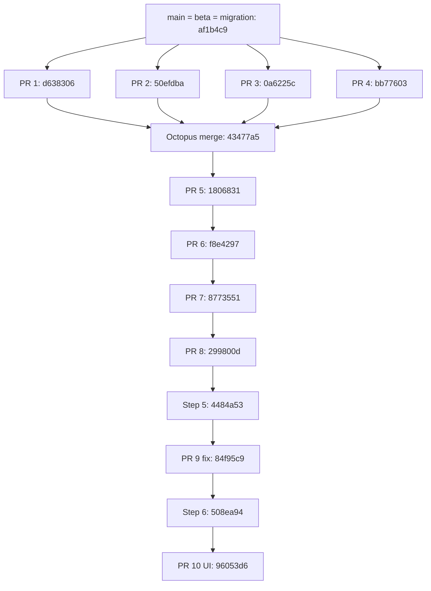

# Git-історія та залежності PR

2026-11-20. Base `af1b4c975564bac916db079d8470c2394d4920e5`; latest `96053d66eb984cc24e3acce647a55a195136abd2`. Primary checkout лишається на migration branch; local main/migration і remote beta snapshot однакові. Локальної beta гілки на старті немає. Fetch створив тільки `refs/audit/phase4/*` і remote-tracking origin/beta; не пересунув робочі branches.

**PR1–4 незалежні sibling commits від baseline. PR5 містить їх через справжній чотирибатьківський octopus merge43477a5. Далі5→6→7→8→9→10 — накопичувальний ancestry chain. PR10 містить всі commits кожного з попередніх дев’яти.**

Редагований native diagram: [pr-dependency-graph.drawio](pr-dependency-graph.drawio). XML обраний для явного розташування чотирьох sibling heads; перевірено XML, IDs, endpoints, geometry. PNG export/desktop layout не потрібний для цього документа.

## Повні heads

| Ref | SHA |
|---|---|
| main / beta snapshot / codex/migrate-0.41.4.1 | `af1b4c975564bac916db079d8470c2394d4920e5` |
| PR#1 | `d6383064276c13863b3d540ccf4e461408db3d69` |
| PR#2 | `50efdbac3c860f0a5e8ed63e5c465f2e3f2ddfef` |
| PR#3 | `0a6225c9f6c6c4d7770ce127846b3f65e30cae2c` |
| PR#4 | `bb77603d9734ed1b729c3932a9a0ed0267a4a7ad` |
| PR#5 | `1806831cd2bcf934e45af7fd89cbf1c64bc262ef` |
| PR#6 | `f8e42970fe336fcd308fd92ee9e2671293265a7e` |
| PR#7 | `877355144ad6322ac7b00ae4a1de185fe4440b63` |
| PR#8 | `299800d9fd2294fa022e84d373969fb6b17160a9` |
| PR#9 | `84f95c9c76db802f2774a8201850f3817bfae9e2` |
| PR#10 | `96053d66eb984cc24e3acce647a55a195136abd2` |

## Перевірки історії

- `git merge-base` між base та кожним PR = baseline SHA; не виводимо ancestry із кількості commits.
- `git merge-base --is-ancestor <PRn> <PR10>`: exit0 для всіх1–9. `git rev-list <PRn> --not <PR10>`: порожній для кожного. Незалежних older-head commits, відсутніх у10, **0**.
- 1–4 не є ancestors один одного; у merge43477a5 всі чотири heads є безпосередніми parents. Після merge —8 non-merge feature/fix commits: Step1–Step6, sprite fix, What’s New.
- `git log --graph --all --decorate`; `git log --ancestry-path af1b4c9..96053d66`; усі parents записані у history.json.
- `git range-diff af1b4c9..1806831c af1b4c9..96053d66`: усі5 shared non-merge patches мають `=`;7 нових patches у другому range. Merge commit показаний окремо через parent graph.
- `git patch-id --stable` усіх12 non-merge commits: **0 груп дубльованих patches**. Спільні SHA повторюються в cumulative PR lists, але це ті самі commit objects. Всього у10 **13 унікальних commits**, один із них merge.
- Переписаної історії між наявними heads не виявлено. Без попередніх remote snapshots неможливо заперечити будь-який force-push у минулому; висновок стосується отриманого graph.
- API mergeable=true/clean для всіх10 до unchanged beta; actual merge/worktree merge не виконували. Семантичні конфлікти й runtime bugs існують незалежно від clean textual merge.
- Ancestry доводить збереження commits, а не незмінність кожної старої реалізації: наступні PR переробляють balance, state machines і UI. Окремий fix84f95c9 з PR9 і фінальний UI/translation96053d6 присутні у10; жодне older PR виправлення не загублене за commit ancestry.

## Як уникнути подвійного застосування

Після узгоджених fixes використати одну cumulative integration branch від10 і один integration PR до beta, зі збереженням ancestry. Не cherry-pick/squash десять cumulative diff по черзі. Альтернатива — спочатку окремі1–4 зі збереженням parents, далі descendants; вона потребує більше merge/retest кроків. Закриття redundant PR — лише після погодження з OKREDU; тут нічого на GitHub не змінювали.

Повний план і gates: [INTEGRATION_STRATEGY](INTEGRATION_STRATEGY.md). Докази: [history.json](../../../dist/phase4_pr_audit/history.json), [history_graph.txt](../../../dist/phase4_pr_audit/history_graph.txt), [ancestry_path.txt](../../../dist/phase4_pr_audit/ancestry_path.txt), [range_diff.txt](../../../dist/phase4_pr_audit/range_diff.txt), [patch_ids.json](../../../dist/phase4_pr_audit/patch_ids.json).
